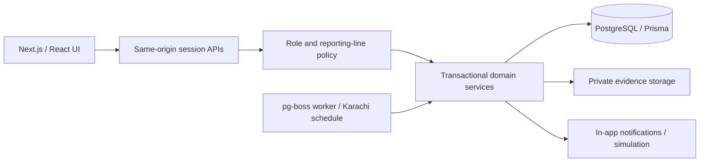

# First milestone architecture

## Runtime boundaries

One Next.js application owns the web UI, authenticated route handlers, and domain services. React receives only authorized, serialized data. Prisma uses the supported JavaScript PostgreSQL adapter; PostgreSQL is the durable source of truth. A separate process from the same codebase runs pg-boss's persistent follow-up queue and cron schedule. This is not a separate application microservice.



The initial design reference is retained in `.local/design-reference.png`. Its navy/charcoal palette, blue controls, sidebar, four metrics, task table, attention panel, and division workload layout guide the UI. Generated sample role/department labels are superseded by the confirmed master hierarchy. Task data, dates, status labels, row counts, and responsive states come from working software rather than the reference image.

## Core data

- Institution → campuses and nested departments.
- Users carry one authorization role, a separate job title, institution/campus/department placement, a formal manager, active status, explicit delegation/cross-department grants, and sensitive HR/finance grants.
- Tasks preserve root/parent lineage, originating requester, immediate delegator, original accountable owner, current executor, reporting-manager snapshot, institution/department, deadline, priority, classification, mandatory-child flag, publication timestamp, and current version.
- Activities and audit logs append events. Approvals preserve the reviewer decision. Notifications, deadline requests, attachments, escalation events, and automation policy are separate records.
- Opaque sessions store only token hashes. Login-attempt counters are persistent. A singleton bootstrap record closes initial CEO setup.
- pg-boss owns its queue tables in a separate database schema.

Future attendance, device mappings, assets, maintenance work orders, AI action proposals, and dependency scheduling will extend this schema after their respective modules are approved. They are not claimed as implemented by empty tables.

## Confirmed organization

```text
CEO
├── Finance Director
│   └── Accounts Head → Accounts staff
└── Operations Director
    ├── Academic Department Head (includes Principals) → Academic staff
    ├── HR & Administration Head
    │   └── Maintenance Supervisor → Maintenance Technicians
    ├── Admissions Head → Admissions staff
    └── IT Head → IT staff
```

The seed and initial department structure follow this chart. CEO-authorized configuration can evolve the reporting tree without rewriting application constants. Both director roles must report to the CEO. Cycles and cross-institution reporting are rejected, with a CEO reporting exception for oversight of multiple institutions. Employee delegation requires an explicit grant and an authorized target; an authorized employee can have reports.

## Permission matrix

| Actor | Operational visibility | Assignment/delegation | Configuration |
| --- | --- | --- | --- |
| CEO | All institutions and tasks, including sensitive records | Any active operational employee except self; no self-approval | Employee roles/reporting/grants, departments, institutions, campuses, policy |
| Finance / Operations Director | Self and formal reporting descendants, subject to classification | Authorized descendants when delegation is granted | No employee authority changes |
| Department Head / Supervisor | Self and formal reporting descendants, subject to classification | Authorized descendants when delegation is granted | No employee authority changes |
| Employee | Own participation and authorized reporting scope | Only with explicit delegation authority; cross-department employee assignment requires a separate explicit grant | No authority changes |
| System Administrator | Structural directory; no task/evidence access through technical role alone | None | Institution, campus, and department structure |

Sensitive records additionally require the appropriate explicit HR/finance grant, including for executors. Delegated children preserve their parent's classification. Unpublished tasks are visible only to their creator and CEO, even after cancellation. Notifications and activity previews are filtered by current task visibility. Inactive manager nodes remain traversable for active director oversight; inactive employees cannot authenticate or receive new assignments.

Task authorization is enforced in server domain services used by APIs and the rules engine. Database constraints independently enforce referential integrity, institution consistency, immutable lineage, graph-cycle protection, and append-only history. Row-level security is not enabled; database credentials are server-only and must not be granted to browsers or ordinary staff.

## Lifecycle and concurrency

| Current state | Actor/action | Next state or effect |
| --- | --- | --- |
| Draft | Authorized creator/manager publishes | Assigned; publication recorded and executor notified |
| Assigned | Executor acknowledges | Acknowledged |
| Acknowledged | Executor starts / reports blocker | In Progress / Blocked |
| In Progress | Executor blocks / submits | Blocked / Submitted for Review |
| Blocked | Executor resumes | In Progress |
| Submitted for Review | Separate authorized manager reviews | Completed / Changes Requested |
| Changes Requested | Executor resumes, blocks, or resubmits | In Progress / Blocked / Submitted for Review |
| Any open state | Authorized manager cancels after resolving children | Cancelled |
| Any visible state | Participant comments | New immutable activity; lifecycle unchanged |

Completion requires all mandatory direct children to be Completed; applying this recursively at each level preserves the entire mandatory chain. Child completion does not close its parent. A completed/cancelled task cannot be reassigned, acquire evidence, or be reopened through the current workflow. Historical comments do not alter completion metrics, which use approval timestamps.

Mutations use serializable transactions with bounded retries. Client mutations require the current task version; concurrent stale edits return a conflict. Reassignment preserves original accountability and does not publish drafts. Parent/root edges are immutable after creation, eliminating reparenting cycles. Approved extensions preserve parent deadline bounds.

## Auth and uploads

Passwords use salted scrypt; high-entropy opaque session tokens are hashed in PostgreSQL with an eight-hour expiry. Cookies are HttpOnly, SameSite=Lax, and Secure under HTTPS configuration. State-changing requests require the configured APP_URL Origin and reject cross-site requests. Initial bootstrap requires the private setup token and a transaction-protected singleton. Account edits revoke existing sessions.

Evidence is limited to 2 MB per file and PDF/PNG/JPEG/plain text. File signatures are checked where applicable; random storage keys avoid path traversal. Files are served as authorized attachments, never executable public assets. Production shared storage, scanning, and quotas remain deployment work. CSP uses per-request script nonces; development alone permits eval for Next.js tooling, while inline styles support component geometry.

## Scheduling and integration assumptions

Operational time is Asia/Karachi. Working days, hours, holidays, reminders, and escalation intervals are configurable. The development defaults are explicitly provisional. Dedupe keys and unique escalation records prevent retries from duplicating in-app notifications. Escalation follows the executor's current formal manager chain, independent of direct CEO assignment. No LLM enforces time or authorization.

No live AI provider is called. The briefing and reminders are labeled rules-based simulation. External communication requires a later configured and authorized channel. ZKTeco integration will use an adapter selected only after the device model/protocol is known; mock attendance must not collect biometric templates. Maintenance will reuse authorized task workflows under HR & Administration.

## Next phases

1. Review this foundation against actual staff, institutions, permission exceptions, and work calendars; add account recovery and a controlled onboarding procedure.
2. Extend the task engine with dependencies, richer review policy, and durable AI action proposals/evaluations.
3. Connect OpenAI structured tool calling after secure provider setup; retain deterministic permissions and scheduling.
4. Add mock attendance and maintenance workflows before live device/messaging integrations.
5. Complete production storage, backups/restore validation, monitoring, rate-limit infrastructure, and deployment review before real staff use.
